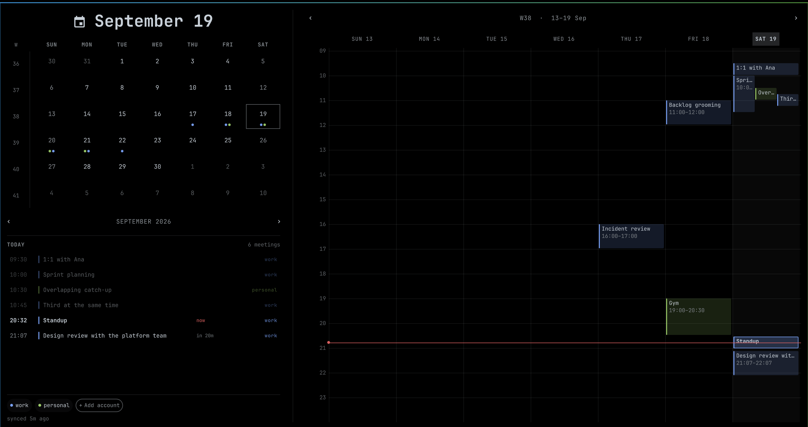

# omarchy-calendar

A replacement for Omarchy's clock widget: the time, plus the meeting you are in
and the one about to start, with a month + week calendar behind it and alerts
before a meeting begins.




- **Bar**: `Saturday 17:53 ● Standup now ● 1:1 in 25m`. The upcoming meeting
  appears only inside the next hour — nothing at 13:59 for a 15:00 meeting, the
  label at 14:00. Clicking a meeting opens its link; clicking the clock opens
  the calendar; right click walks the clock formats; middle click opens the
  timezone picker.
- **Panel**: month on the left with a dot per account per day, the day's agenda
  under it, and the week on the right drawn like a calendar app — overlapping
  meetings share the width of their cluster instead of hiding behind each other.
- **Alerts**: 5 minutes and 1 minute before, as a critical notification so it
  bypasses Do Not Disturb and waits on screen instead of expiring. Clicking it
  opens the meeting link.
- **Several accounts**, each with a precedence. When two meetings overlap, the
  bar shows the one whose account ranks higher; both still alert.

## Install

```bash
./install.sh          # symlink, python venv, sync timer, takes the clock's slot
omarchy restart shell
```

`install.sh` swaps `omarchy.clock` for `eduardo.calendar` in
`~/.config/omarchy/shell.json` (keeping a timestamped backup) and moves the
bar's center anchor with it.

## Connecting a Google account

Google requires an app identity for calendar access, and there is no way round
it: app passwords stopped working for CalDAV/IMAP in March 2025, and API keys
only reach public calendars. So there is one manual step, once:

1. Open <https://console.cloud.google.com/auth/clients> in a project of your own.
2. Enable the **Google Calendar API** for that project.
3. Configure the consent screen, then create an **OAuth client → Desktop app**.
4. Download the JSON and save it as `~/.config/omarchy-calendar/client_secret.json`.

Then click **+ Add account** in the panel, type a label (`work`, `other`), and
the browser opens for consent. The token lands in
`~/.local/share/omarchy-calendar/tokens/<label>.json` (0600) and the sync timer
starts itself.

### Which consent screen to pick

| Consent screen | Refresh token | Who can sign in |
|---|---|---|
| **Internal** (Workspace project) | never expires | only that Workspace's accounts |
| **External + Testing** | **revoked every 7 days** | test users you list |
| **External + Production** | never expires | anyone, past an "unverified app" warning |

Internal is the best answer for an account in the same Workspace as the project.
A second account from a different organization cannot use an Internal client, so
either give it its own client in a project of its own, or publish one External
client to Production and accept the warning screen once. On Testing you will be
re-authorizing every week — the panel shows the account in red when its token
dies, and clicking the chip re-opens the browser.

## Configuration

`~/.config/omarchy-calendar/config.json`:

```json
{
  "version": 1,
  "accounts": [
    { "label": "work", "email": "you@work.com", "priority": 1, "color": "#7aa2f7", "calendars": ["*"], "enabled": true }
  ],
  "leadMinutes": [5, 1],
  "upcomingWindowMinutes": 60,
  "syncWindowDays": 60,
  "syncPastDays": 7,
  "catchUpMinutes": 10,
  "maxTitleChars": 28,
  "filters": {
    "skipDeclined": true,
    "skipAllDay": true,
    "skipSolo": true,
    "skipFree": true
  }
}
```

`priority` is precedence: 1 wins the bar over 2 when their meetings overlap.
Clicking a chip opens its actions — rename, sync now, move up/down, sign in
again when its token died, and remove (which asks once, because it throws the
token away too). `calendars: ["*"]` means every calendar the account can see; list
calendar ids instead to narrow it.

The filters drop events at sync time, before anything sees them: ones you
declined, all-day events, solo blocks with no other attendees, and anything
marked Free. An account can override any of them — a work calendar wants focus
blocks and holidays out of the way, a personal one is mostly those:

```json
{ "label": "personal", "filters": { "skipAllDay": false, "skipSolo": false, "skipFree": false } }
```

All-day events that survive the filters appear as a strip above the week grid,
a row in the agenda and a dot in the month — never in the bar, and they never
alert. Holiday calendars mark their entries **Free**, not just all-day, so
seeing holidays needs `skipFree: false` too.

Widget settings (clock format, week start) live on the bar entry in
`shell.json`, the same keys the stock clock used.

## When the calendar looks empty

```bash
./bin/omarchy-calendar-sync --explain
```

Prints every calendar it can see, how many events are in the window, and what
each filter dropped:

```
dawere (you@work.com)
  you@work.com              218 found,  98 kept (dropped: allDay 48, solo 72)
  Holidays in Spain           3 found,   0 kept (dropped: allDay 3)
```

## Calendars from an organization that won't approve the app

When an admin blocks unconfigured third-party OAuth clients and you would
rather not file a request, read that calendar from its own feed instead. In
that account's Google Calendar: Settings → the calendar → **Integrate
calendar** → **Secret address in iCal format** (the URL, not the Export
download — an exported file is a snapshot and is stale immediately).

```bash
./bin/omarchy-calendar-ics --label otherjob --email you@otherjob.com \
  --url 'https://calendar.google.com/calendar/ical/.../private-.../basic.ics'
```

That URL is a credential: anyone holding it can read the calendar, so it lands
in `config.json` (0600) and should never be pasted anywhere public. `--email`
is what lets the parser tell your own attendance from everyone else's, so
`skipDeclined` and `skipSolo` keep working on this source.

Recurring events arrive as rules rather than occurrences here, so they are
expanded locally — `RRULE`, `RDATE`, `EXDATE` and `RECURRENCE-ID` overrides for
individually moved instances, in the event's own timezone.

The one thing this route cannot promise is freshness: Google regenerates that
file on its own schedule, not when you ask. Measure it rather than assume:

```bash
./bin/omarchy-calendar-ics --label otherjob --measure-lag
```

It takes a baseline, you change something in that calendar, and it reports how
long the feed took to catch up. Anything above a couple of minutes means the
alerts for that account can be wrong about a meeting that just moved.

## If your Workspace blocks third-party apps

An admin setting ("block unconfigured third-party apps") stops consent before
it starts. Allowlist this one client instead of lifting the restriction:
Admin console → Security → Access and data control → **API controls** →
**Manage Third-Party App Access** → Configure new app → search by **OAuth Client
ID**, not by app name — custom apps are not indexed by their display name.

## What it cannot do

Worth knowing before you rely on it:

- **Asleep at T-1min**: the timer does not run while suspended. On resume it
  syncs and alerts for anything that started in the last 10 minutes, so you get
  a late alert rather than none — but late is late.
- **Shell down**: alerts come from the bar widget, so a crashed or restarting
  shell at that minute means no alert.
- **Locked screen**: the session lock renders above notifications. The toast
  never expires, so it is waiting when you unlock.
- **Stale data**: the sync runs every 60s and every pass re-derives the alerts
  from the file, so a meeting that moves is picked up within a minute. Offline,
  the panel keeps showing the last good data and says how old it is.
- **Overlaps in the bar**: only the precedence winner is shown there. The other
  meeting is in the panel, and still alerts.

## Development

```bash
node test/model-test.js          # date, overlap packing, bar selection, alerts
./test/ics-test.py               # recurrence, exceptions, moved instances, filters
./test/fixture.py --config       # believable events.json without touching Google
omarchy restart shell            # QML lives behind a symlink, so edits need this
journalctl --user -o cat _COMM=quickshell | rg eduardo.calendar
```

IPC: `omarchy-shell eduardo.calendar {open,close,toggle,refresh,sync,cycleFormat,toggleWeekStart}`

Keys in the panel: `←/→` month, `↑/↓` year, `,`/`.` week, `t` today, `w` week
start, `r` sync now, `Esc` close.

Month grid and ISO week math are adapted from Omarchy's own clock plugin (MIT).
